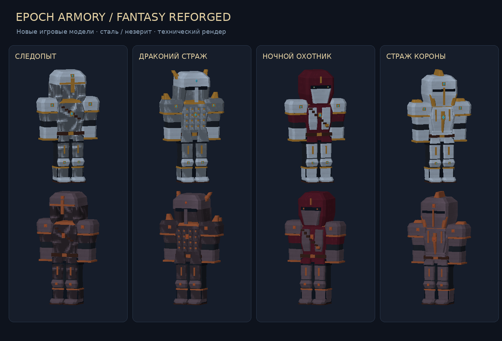
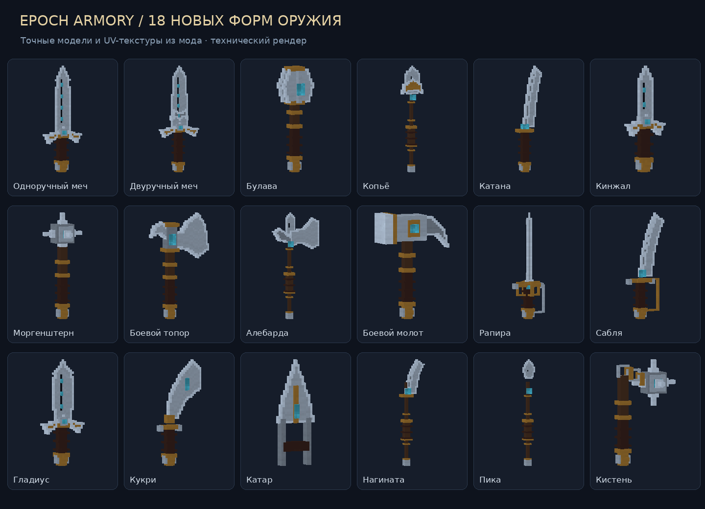
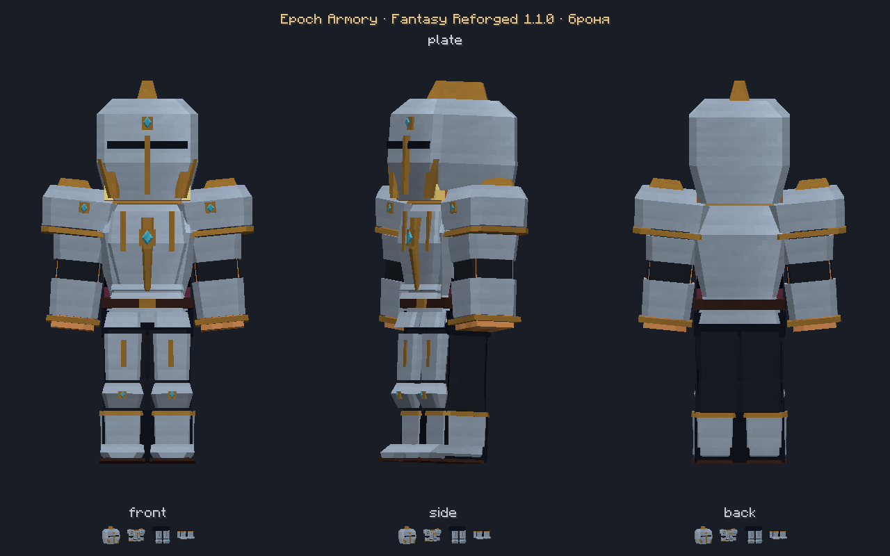

# Epoch Armory — Fantasy Reforged 1.1.0

Мод для **Minecraft 1.21.1 · NeoForge 21.1.262 · Java 21**. Оружие, доспехи, щиты и кузнечная мастерская в стиле эпического фэнтези.

## Скачать

- **[Готовый мод — JAR](https://github.com/stisvladnext3-creator/minecraftmodding/releases/download/v1.1.0/epocharmory-1.1.0%2Bmc1.21.1.jar)**
- **[Полные исходники — ZIP](https://github.com/stisvladnext3-creator/minecraftmodding/releases/download/v1.1.0/EpochArmory-1.1.0-NeoForge-1.21.1-source.zip)**
- [Страница релиза и контрольные суммы](https://github.com/stisvladnext3-creator/minecraftmodding/releases/tag/v1.1.0)

Установи NeoForge 21.1.262 для Minecraft 1.21.1 и положи JAR в папку `mods`. При обновлении убери предыдущий JAR Epoch Armory. Этот же файл используется на клиенте и сервере. Дополнительные моды не требуются.

## Броня

160 частей брони: четыре конструкции и десять материалов. Новые объёмные нагрудники, наплечники, шлемы со скосами, наколенники и металлическая отделка. Образы: следопыт, драконий страж, ночной охотник и страж короны.

## Оружие

Все 18 форм и 180 материальных вариантов переработаны. Новые клинки, гарды, обмотки, ударные головки и цветные вставки.

## Снимки из Minecraft

Технические каталоги выше отрендерены из геометрии и текстур мода. Ниже — неизменённый снимок настоящего клиента Minecraft с новым комплектом лат.

Все новые игровые снимки: [броня](art/qa), [оружие](art/qa/weapons), [щиты](art/qa/shields). У 100 щитов обновлены отделка и гербы, сохранены формы, хват и положения блокирования.

## Проверки и исходники

Сборка успешна, все **14 обязательных серверных GameTest прошли**. Клиентские проверки брони, щитов и оружия завершились успешно; получен **141 игровой снимок**. Идентификаторы предметов, 707 рецептов станков и параметры боя сохранены.

- [Подробное руководство, производство и бой](README_RU.md)
- [Результаты проверок и команды для воспроизведения](VALIDATION_RU.md)
- [Баланс](BALANCE_RU.md) · [Рецепты](CRAFTS_RU.md)

Для сборки нужен JDK 21: `./gradlew build` на Linux/macOS или `gradlew.bat build` на Windows. JAR появится в `build/libs`. Модели и текстуры уже включены, Python для обычной сборки не нужен.
